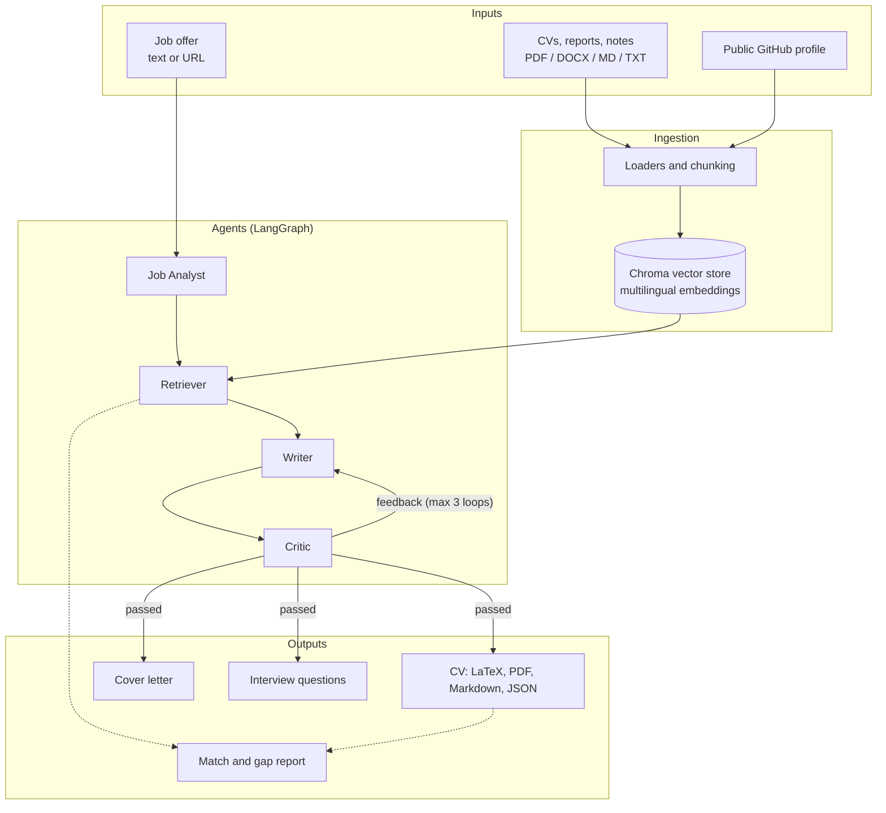
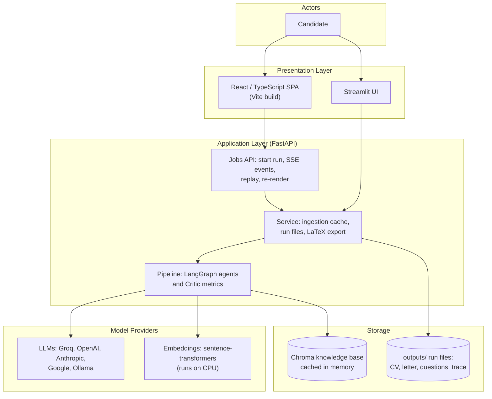

<div align="center">

# CareerForge - Fact-Grounded CV & Job Application Generator

**An agentic web application that builds a personal knowledge base from your own documents and uses a team of LLM agents to write, critique and fix a CV tailored to each job offer, without inventing experience.**

[](https://github.com/mtgfz/careerforge)
[](https://www.python.org/)
[](https://fastapi.tiangolo.com/)
[](https://www.langchain.com/)
[](https://langchain-ai.github.io/langgraph/)
[](https://react.dev/)
[](https://www.typescriptlang.org/)
[](https://vitejs.dev/)
[](https://streamlit.io/)
[](https://www.docker.com/)
[](https://github.com/features/actions)
<br />

<p align="center">
  <a href="#overview">Overview</a> |
  <a href="#demo">Demo</a> |
  <a href="#key-features">Key Features</a> |
  <a href="#agent-based-architecture">Agents</a> |
  <a href="#system-architecture">Architecture</a> |
  <a href="#data-model">Data Model</a> |
  <a href="#tech-stack">Tech Stack</a> |
  <a href="#getting-started">Getting Started</a> |
  <a href="#configuration">Configuration</a> |
  <a href="#evaluation">Evaluation</a> |
  <a href="#testing">Testing</a> |
  <a href="#limits-and-ethics">Limits</a> |
  <a href="#repository-structure">Structure</a> |
  <a href="#authors">Authors</a>
</p>

</div>

---

## Overview

**CareerForge** is a job application copilot. Instead of filling a template with a single prompt, it ingests your own material (CVs, reports, notes, public GitHub repositories) into a vector knowledge base, analyses the job offer, retrieves the strongest evidence for every requirement, and lets a **Writer** and a **Critic** agent iterate until the CV is faithful to what you can actually prove.

Every bullet of the generated CV cites the evidence chunks that support it, and unsupported claims are pruned before export. The same run also produces a cover letter and interview questions. The whole workflow is orchestrated with **LangGraph**, served by **FastAPI**, and used through a **React / TypeScript** web app (a Streamlit UI is also available).

---

## Demo

Generate a run once in the web app, then record it so it can be replayed later **without any LLM call** (a safe plan B for a live presentation):

```bash
python scripts/save_demo.py <run_id>
```

Commit the generated `demo/` folder, and the app will offer the recorded run in its replay list.

<!-- Add a link to a video demonstration of the web app here. -->

---

## Key Features

### 1. Fact-Grounded CV Generation
* **Personal Knowledge Base:** Loads PDF, DOCX, Markdown, text files and public GitHub repositories, then chunks and embeds them with multilingual embeddings (French and English CVs work out of the box).
* **Job Analysis:** Turns the offer into a structured profile (requirements with importance, seniority, language, ATS keywords). The offer can be pasted or imported from a URL.
* **Evidence Retrieval (RAG):** For every requirement, retrieves the candidate's strongest evidence, with optional hybrid search (BM25 + dense) and a cross-encoder reranker.
* **Cited Writing:** The Writer uses **only** retrieved evidence, and every bullet carries the IDs of the chunks that support it.
* **No Invented Contact Details:** Name, email, phone and links come from the user and are never generated by the model.

### 2. Quality Control Loop
* **Writer <-> Critic Loop:** The Critic scores the CV and sends actionable feedback back to the Writer (up to `MAX_ITERATIONS`, with an early stop when the score plateaus).
* **Pruning:** Bullets, skills and titles that the judge cannot support with evidence are removed from the returned CV.
* **Best-of-N Strategy:** Optionally writes N candidates in parallel at different temperatures and keeps the best-scored one.
* **Model Chain & Roles:** Several models can be listed in order of preference (the next one answers when a model is overloaded, slow or out of quota). A light model and a separate judge model can be configured.
* **Match & Gap Report:** Classifies each requirement as matched, in the profile but missing from the CV, partial, or missing.

### 3. Job Application Copilot (Web App)
* **Live Progress:** Step-by-step progress streamed with Server-Sent Events, with per-step timings.
* **Critic Loop Chart:** Scores per iteration and the claims rejected at each pass.
* **Evidence Per Bullet:** Inspect which evidence supports every bullet and how well the CV covers the offer's keywords.
* **Editable CV:** Edit the generated CV by hand and re-export it as LaTeX / PDF / Markdown in 3 templates.
* **Cover Letter & Interview Questions:** Generated in parallel from the final CV.
* **Replay Mode:** Replay a recorded run with no LLM call.

---

## Agent-Based Architecture

The pipeline is a LangGraph workflow made of five cooperating components:

| Agent | Module | Primary Responsibilities |
| :--- | :--- | :--- |
| **Ingestion** | `src/ingestion/` | Load PDF / DOCX / MD / TXT, GitHub repos and job URLs, chunk and embed them into the Chroma store |
| **Job Analyst** | `src/agents/job_analyst.py` | Offer -> structured `JobProfile` (requirements, importance, ATS keywords) through Pydantic structured output |
| **Retriever** | `src/agents/retriever.py` | RAG: fetch the strongest evidence chunks for every requirement |
| **Writer** | `src/agents/writer.py` | Write impact-style bullets using **only** retrieved evidence, each citing evidence IDs |
| **Critic** | `src/agents/critic.py` | Score faithfulness, ATS match and quality, and send feedback to the Writer |
| **Extras / Gap Analyst** | `src/agents/extras.py`, `src/agents/gap_analyst.py` | Cover letter, interview questions, and the match and gap report |



### Critic Metrics

| Metric | How it is computed |
| :--- | :--- |
| **Faithfulness** | Share of bullets and skills grounded in the evidence. A bullet counts only if it cites valid evidence IDs **and** an LLM judge confirms the evidence supports every claim. Skills must literally appear in the evidence. |
| **ATS score** | 50% job keyword coverage + 50% embedding cosine similarity between the CV and the offer |
| **Quality** | LLM-as-judge rubric (clarity, impact, action verbs, concision) |
| **Overall** | `0.4 x faithfulness + 0.3 x ATS + 0.3 x quality`. The loop stops when faithfulness and overall pass their thresholds, when the score stops improving, or after `MAX_ITERATIONS`. |

### Design Choices
* **Why not RNN / LSTM?** Pretrained transformer embeddings (`paraphrase-multilingual-MiniLM`) capture semantics across French and English CVs without any training. An LSTM would need labeled data and would perform worse, and LLMs already handle the generation.
* **No invented experience:** grounding + citation check + judge, with an ablation to measure its effect (see [Evaluation](#evaluation)).
* **Judge separate from writer:** a different `JUDGE_MODEL` (or family) reduces self-grading bias.

---

## System Architecture



The React app is built once (`npm run build`) and served by the same FastAPI process, so the whole application runs on **one port**.

---

## Data Model

All agents share typed Pydantic schemas (`src/schemas.py`), so every LLM call returns validated structured output:

| Entity | Key Attributes | Relationships |
| :--- | :--- | :--- |
| **Candidate** | `name, email, phone, location, links` | Supplied by the user, rendered in the CV header |
| **JobProfile** | `title, company, seniority, language, requirements, keywords` | Has many `Requirement` |
| **Requirement** | `name, kind, importance (1-5)` | Belongs to `JobProfile`, linked to evidence by the Retriever |
| **EvidenceChunk** | `id, text, source, score` | Grouped by requirement inside an `EvidencePack` |
| **EvidencePack** | `chunks, by_requirement` | Input of the Writer and the Critic |
| **GeneratedCV** | `headline, summary, skills, experiences, projects, education, languages` | Has many `CVEntry` |
| **CVEntry** | `title, organization, period, bullets` | Has many `CVBullet` |
| **CVBullet** | `text, source_ids` | Cites `EvidenceChunk` IDs |
| **Critique** | `faithfulness, ats, quality, overall, unsupported_*, missing_keywords, feedback, passed` | Scores one `GeneratedCV` and feeds the Writer |

---

## Tech Stack

| Layer | Technologies |
| :--- | :--- |
| **Orchestration** | LangGraph (conditional Writer <-> Critic loop), LangChain Core |
| **LLM Providers** | Groq, OpenAI, Anthropic, Google Gemini, Ollama (local, no key) |
| **Embeddings & Retrieval** | sentence-transformers (`paraphrase-multilingual-MiniLM-L12-v2`), ChromaDB, optional BM25 hybrid search and cross-encoder reranker |
| **Backend** | Python 3.11, FastAPI, Uvicorn, Pydantic 2, Server-Sent Events |
| **Ingestion** | pypdf, pdfplumber, python-docx, requests (GitHub and job URLs) |
| **Frontend** | React 18, TypeScript 5.6, Vite 5, Recharts |
| **Alternative UI** | Streamlit |
| **Export** | LaTeX to PDF (TeX Live), Markdown, JSON |
| **Evaluation** | pandas, matplotlib, tabulate, Jupyter notebook |
| **Testing & CI** | pytest, GitHub Actions (offline tests with a fake LLM) |
| **DevOps** | Docker multi-stage build, Docker Compose |

---

## Getting Started

### Prerequisites
* [Python 3.11+](https://www.python.org/)
* [Node.js 20+ & npm](https://nodejs.org/) (to build the React app)
* An LLM API key, such as [Groq](https://console.groq.com/) (free tier available), or [Ollama](https://ollama.com/) for a fully local model
* [TeX Live](https://www.tug.org/texlive/) (optional, for PDF export; included in the Docker image)
* [Docker](https://www.docker.com/) (optional)

---

### Step-by-Step Installation

1. **Clone the repository:**
   ```bash
   git clone https://github.com/mtgfz/careerforge.git
   cd careerforge
   ```

2. **Create a virtual environment and install the backend dependencies:**
   ```bash
   python -m venv .venv
   source .venv/bin/activate        # Windows: .venv\Scripts\activate
   pip install -r requirements.txt
   ```

3. **Configure the environment:**
   ```bash
   cp .env.example .env             # Windows: copy .env.example .env
   ```

4. **Add your model settings and API key in `.env`:**
   ```env
   LLM_PROVIDER=groq
   LLM_MODEL=llama-3.3-70b-versatile
   GROQ_API_KEY=your_api_key
   ```
   No API key? Use a local model: `LLM_PROVIDER=ollama` and `LLM_MODEL=llama3.1`.

5. **Build the React web app:**
   ```bash
   cd frontend
   npm install
   npm run build
   cd ..
   ```

6. **Start the application (UI and API in one process):**
   ```bash
   uvicorn src.api.main:app
   ```
   Open `http://localhost:8000` in your web browser. The API documentation is at `http://localhost:8000/docs`.

---

### Other Ways to Run

**Docker** (builds the React app and includes LaTeX for PDF export):
```bash
cp .env.example .env
docker compose up --build
```
Then open `http://localhost:8000`.

**Development mode with hot reload** (two terminals):
```bash
uvicorn src.api.main:app --reload          # terminal 1: API
cd frontend && npm run dev                 # terminal 2: React app
```

**Streamlit UI:**
```bash
streamlit run app/streamlit_app.py         # http://localhost:8501
```

---

### API Endpoints

| Method | Route | Description |
| :--- | :--- | :--- |
| `POST` | `/api/jobs` | Start a generation run (multipart form), returns a job ID |
| `GET` | `/api/jobs/{id}/events` | Live progress as Server-Sent Events |
| `POST` | `/api/runs/{run_id}/render` | Re-export a CV edited by hand |
| `GET` | `/api/replays` | List recorded runs |
| `POST` | `/api/replay/{run_id}` | Replay a recorded run without any LLM call |
| `GET` | `/api/config` | Current application configuration |
| `GET` | `/download/{run_id}/{file}` | Download a generated file (PDF, LaTeX, Markdown, JSON, letter, questions) |

---

## Configuration

Everything is set in `.env` (see `.env.example` for the full list).

| Variable | Purpose |
| :--- | :--- |
| `LLM_PROVIDER`, `LLM_MODEL` | Main model. `LLM_MODEL` can be a comma-separated list in order of preference, and an entry can name its own provider (`groq:openai/gpt-oss-120b`) |
| `LLM_TIMEOUT`, `LLM_MAX_RETRIES` | Per-request timeout and SDK retries for each model of the chain |
| `LIGHT_PROVIDER`, `LIGHT_MODEL` | Lighter model for job analysis, cover letter and questions (spares the writer's quota) |
| `JUDGE_PROVIDER`, `JUDGE_MODEL` | Separate judge model for the Critic (reduces self-grading bias) |
| `JUDGE_FALLBACK_*`, `STRUCTURED_RETRIES` | Backup judge and attempts per structured call |
| `MAX_ITERATIONS`, `FAITHFULNESS_MIN`, `OVERALL_MIN` | Critic loop limits and pass thresholds |
| `STRATEGY`, `BEST_OF_N` | `loop` (default) or `best_of_n` generation strategy |
| `HYBRID_SEARCH`, `RERANKER_MODEL`, `RERANK_POOL` | Retrieval quality knobs (all off by default so the baseline stays comparable) |
| `PLATEAU_DELTA`, `PARALLEL_EXTRAS`, `REJUDGE_AFTER_PRUNE` | Speed knobs: stop when the score gain is too small, run letter and questions in parallel, skip the second judge call |
| `KB_CACHE_SIZE`, `GITHUB_CACHE_SECONDS` | Cache of embedded knowledge bases and GitHub profiles |
| `GITHUB_TOKEN` | Optional, raises the GitHub API rate limit |

Keep `REJUDGE_AFTER_PRUNE=true` for the ablation so the reported scores are re-measured.

---

## Evaluation

### Dataset: 5 real CV / offer pairs
Real pairs live in `data/private/pairs/` (git-ignored because they contain personal data), one folder per pair:

```
data/private/pairs/01_ml_intern/
  cv.pdf            one or more candidate files (pdf, docx, md, txt, tex)
  job.txt           the offer text, or job.url with its URL (fetched once, cached)
  candidate.json    optional: {"name": "...", "github": "username"}
```

Without real pairs, every command falls back to `--sample`: the fictional sample CV against the 5 sample offers (one of them in French).

### Proof run
```bash
python scripts/run_proof.py
```
For each pair, it writes the CV (md / tex / pdf), cover letter, interview questions, match report and a full trace (evidence, every Critic pass) to `outputs/proof/<pair>/`, plus a summary table in `outputs/proof/index.md`.

### Ablation
```bash
python -m eval.ablation --repeats 2     # add --variants ... low_recall for the retrieval ablation
python -m eval.analysis                 # rebuild the report from eval/results.jsonl
```

| Variant | What runs |
| :--- | :--- |
| `single_pass` | Writer only, no Critic (baseline) |
| `critic_once` | One Critic pass: unsupported claims are pruned, no rewrite |
| `full` | Full Writer <-> Critic loop + pruning |
| `low_recall` | Full system with 1 evidence chunk per requirement instead of 2 |

All variants are scored by the same evaluator on the returned CV. Each run is appended to `eval/results.jsonl` as soon as it ends, so a run interrupted by a free-tier quota resumes where it stopped (`--fresh` starts over). The analysis writes `eval/results.md` (mean and standard deviation, paired comparison against the baseline with wins / ties / losses and an exact sign test, per-pair tables, score per Critic iteration), `eval/results.csv`, `eval/results.png` and `eval/trajectory.png`. Retrieval comparisons (dense, hybrid, hybrid + reranker) are kept in separate folders under `eval/`.

### Match and Gap Report
`src/agents/gap_analyst.py` classifies every requirement of the offer as **matched** (evidence and in the CV), **in profile, not in CV** (evidence the CV left out), **partial** (only related evidence) or **missing** (no evidence). The classification is deterministic (retrieval similarity plus literal checks), and an optional LLM step adds advice for each gap without ever suggesting a skill the candidate lacks. It reports an importance-weighted **profile match** and **CV coverage**.

### Job Offer Import by URL
`src/ingestion/job_url.py` reads the schema.org `JobPosting` that most job boards embed, and otherwise falls back to the page's main text. Only public http(s) addresses are fetched (redirects are re-checked), with a size cap. Sites that need a login or JavaScript (LinkedIn, for example) are refused with a clear message, so the text can be pasted instead.
```bash
python -m src.ingestion.job_url https://example.com/jobs/123 > job.txt
```

### Evaluation Limits
* The Critic is also the evaluator, so the scores measure agreement with the judge rather than ground truth. Use a separate `JUDGE_MODEL` and spot-check `trace.json` by hand.
* With 5 pairs the sign test cannot go below p = 0.0625. Read the results as a consistent trend, not as statistical proof.
* LLM outputs vary between runs: use `--repeats` and report the standard deviation.

---

## Testing

```bash
pytest -q
```

The tests run **offline** with a fake LLM and fake embeddings, so no API key is needed. They cover the metrics, the LaTeX renderer, the LangGraph loop logic (with stub nodes), pruning, retries and the model chain, GitHub ingestion, job URL import, the gap analyst, retrieval quality, the evaluation analysis and the React backend.

The GitHub Actions workflow (`.github/workflows/ci.yml`) runs on every push to `main` and on pull requests: byte-compile, offline tests, and a check that the evaluation report renders.

---

## Limits and Ethics

* The LLM judge can itself be wrong. Faithfulness is a strong signal, not a proof, so always review the CV before sending it.
* Personal data stays local except for the text sent to the chosen LLM provider. Use `ollama` for fully local processing. Free tiers of some providers may use submitted content to improve their products, so avoid real personal CVs there.
* Do not commit real CVs: `data/private/` is git-ignored.

---

## Repository Structure

```
careerforge/
|-- .github/
|   \-- workflows/
|       \-- ci.yml                # Byte-compile, offline tests, report check
|
|-- app/
|   \-- streamlit_app.py          # Alternative Streamlit UI
|
|-- data/
|   |-- sample/                   # Fictional, anonymized sample CV and job offers
|   \-- private/                  # Real CV / offer pairs (git-ignored)
|
|-- eval/                         # Ablation runner, analysis, pair loader, results
|
|-- frontend/                     # React / TypeScript SPA (Vite)
|   \-- src/
|       |-- components/           # CV editor, critic loop chart, scores, progress, profile form
|       |-- api.ts                # API client
|       \-- useJob.ts             # Live job progress hook (SSE)
|
|-- notebooks/
|   \-- demo.ipynb                # Demo notebook
|
|-- scripts/
|   |-- run_proof.py              # Proof run on the CV / offer pairs
|   |-- benchmark.py              # Benchmark script
|   \-- save_demo.py              # Record a run for the replay mode
|
|-- src/
|   |-- agents/                   # job_analyst, retriever, writer, critic, extras, gap_analyst
|   |-- api/                      # FastAPI app (main.py) and jobs API with SSE (jobs.py)
|   |-- ingestion/                # Loaders (PDF, DOCX, GitHub), job URL import, Chroma store
|   |-- render/                   # LaTeX / Markdown rendering and PDF compilation
|   |-- config.py                 # Environment-driven settings
|   |-- graph.py                  # LangGraph workflow
|   |-- llm.py                    # LLM and embedding factories, model chain
|   |-- metrics.py                # Faithfulness, ATS and quality scoring
|   |-- pipeline.py               # Wiring and PipelineResult
|   |-- schemas.py                # Pydantic schemas shared by all agents
|   \-- service.py                # Application service (runs, caches, exports)
|
|-- tests/                        # Offline unit and end-to-end tests
|-- .env.example                  # Environment template
|-- Dockerfile                    # Multi-stage build (React app + API + LaTeX)
|-- docker-compose.yml            # One-service stack on port 8000
|-- requirements.txt              # Python dependencies
\-- README.md                     # Project documentation
```

---

## Authors

Project developed by:
* **[trxshi747 (Yassir Karrouti)](https://github.com/trxshi747)**
* **[mtgfz](https://github.com/mtgfz)**
* **[Abdelalime Lahbib](https://github.com/Abdelalimelah)**
